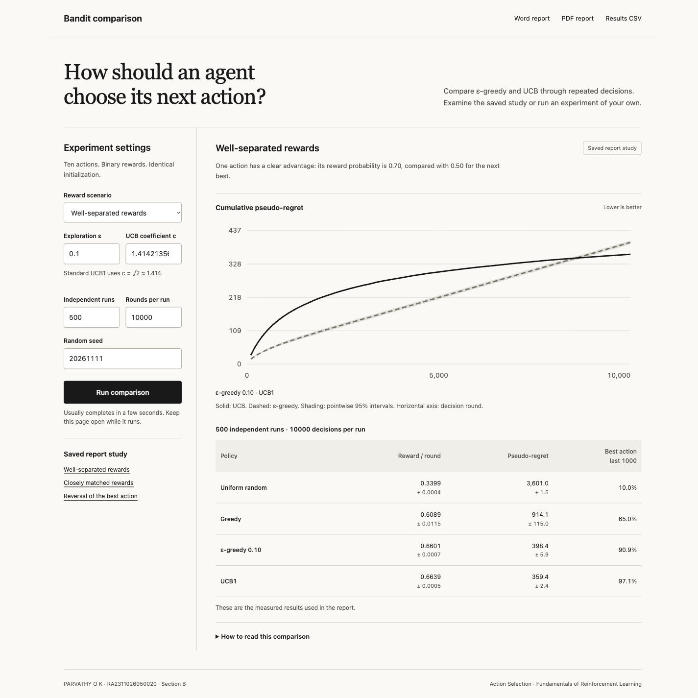

# Comparative Analysis of ε-Greedy and UCB Algorithms for Sequential Decision Making

**PARVATHY O K · RA2311026050020 · Section B**  
**Main topic:** Action Selection  
**Course:** 21CSE417TA / Fundamentals of Reinforcement Learning

A complete local project comparing ε-greedy and UCB1 in ten-armed Bernoulli bandits. It contains a browser dashboard, reproducible numerical experiments, correctness tests, recorded results, original diagrams, and the academic report.



## Start the application

Requires Python 3.12 or newer. No database, account or API key is needed.

```sh
python3 -m venv .venv
source .venv/bin/activate
python -m pip install -r requirements.txt
python -m backend.server
```

Open [the local dashboard](http://127.0.0.1:8000). Stop it with `Ctrl+C`.

On this Mac, **double-click `run.command`** to start the application using the installed Codex Python runtime or a project virtual environment. The script prints the browser address. For another port:

```sh
python -m backend.server --port 8010
```

The dashboard opens the saved report study. Choose a scenario or adjust ε, the UCB coefficient, run count, horizon and seed to run a new comparison. New comparisons do not overwrite the saved study or report. Binary rewards, common initialization and sample-mean updates are fixed in the interactive comparison. The saved reversal scenario also includes a constant-step diagnostic.

## Results in the report

Each main scenario uses **500 independent runs × 10,000 decisions**, with ten actions. Numbers below are mean pseudo-regret; lower is better.

| Scenario | ε-greedy, ε = 0.10 | UCB1, c = √2 |
|---|---:|---:|
| Well-separated rewards | 398.4 | 359.4 |
| Closely matched rewards | 184.0 | 399.9 |
| Reversed rewards after round 5,000 | 2,930.1 | 415.4 |

These are measured synthetic simulations, not real-world observations. The policy ranking changes with the scenario. The report provides intervals, paired differences and limitations. Smaller UCB coefficients in the sensitivity analysis are variants, not standard UCB1.

## Project files

```text
epsilon-greedy-ucb/
├── backend/
│   ├── simulate.py             # ε-greedy, UCB, updates and full study
│   └── server.py               # Local HTTP app and SVG comparison charts
├── frontend/
│   ├── index.html              # Accessible dashboard template
│   └── styles.css              # Responsive grayscale interface
├── tests/
│   ├── test_study.py           # 11 numerical correctness checks
│   └── test_server.py          # 5 dashboard and validation checks
├── data/
│   ├── results.json            # Complete aggregated study and run regrets
│   ├── summary.csv             # Final metrics for every policy/scenario
│   ├── learning_curves.csv     # Checkpoints every 100 decisions
│   └── run_regrets.csv         # Run-level data for paired comparisons
├── report_assets/
│   ├── figures/                # 9 original figures, vector PDF + 300 dpi PNG
│   └── report_template.docx    # Sanitized institutional formatting template
├── reports/
│   ├── Parvathy_OK_Epsilon_Greedy_and_UCB_Report.docx
│   └── Parvathy_OK_Epsilon_Greedy_and_UCB_Report.pdf
├── scripts/
│   ├── export_results.py
│   ├── generate_figures.py
│   ├── generate_report.py
│   └── export_pdf.py
├── docs/                       # Screenshots, methods and verification notes
├── requirements.txt            # Pinned numerical dependency
├── requirements-report.txt     # Optional report-generation dependencies
├── run.command                 # macOS launcher
├── .env.example
└── README.md
```

## Reproduce and test

Run from the repository root:

```sh
python -m unittest discover -s tests -v
python -m backend.simulate
python scripts/export_results.py
```

The study command regenerates `data/results.json`. The export command refreshes the CSV files. The main environment seeds are 20261111, 20261112 and 20261113. Sensitivity seeds are 20262111 and 20262112. Rewards share common potential outcomes across policies; each learner sees only its selected reward. See [the method notes](docs/METHODOLOGY.md) for exact arrays and stream ordering.

The report documents the numerical implementation and study. The browser interface is a local companion to inspect those outputs and conduct additional comparisons. It uses server-rendered HTML/CSS; there is no Node build step.

## Rebuild figures and the report

The completed report and all figures are already included. To regenerate them:

```sh
python -m pip install -r requirements-report.txt
python scripts/generate_figures.py
python scripts/generate_report.py
python scripts/export_pdf.py --office /absolute/path/to/soffice
```

Figure generation requires Poppler's `pdftoppm` and `pdfinfo` on `PATH`, or `POPPLER_PATH` pointing to their folder. The report generator uses the included template and figures; it does not need the WhatsApp reference file. PDF export requires a Word-compatible renderer such as LibreOffice; after changing content, visually check every page and update the contents page if pagination changes. The shipped Word and PDF files have been checked together.

## Report and documentation

- [Word report](reports/Parvathy_OK_Epsilon_Greedy_and_UCB_Report.docx)
- [PDF report](reports/Parvathy_OK_Epsilon_Greedy_and_UCB_Report.pdf)
- [Methodology and reproduction details](docs/METHODOLOGY.md)
- [Verification record](docs/VERIFICATION.md)
- [Final metrics CSV](data/summary.csv)

## References

1. Sutton and Barto (2018), [Reinforcement Learning: An Introduction](https://mitpress.mit.edu/9780262039246/reinforcement-learning/), Chapter 2.
2. Auer, Cesa-Bianchi and Fischer (2002), [Finite-time Analysis of the Multiarmed Bandit Problem](https://doi.org/10.1023/A:1013689704352).
3. Bubeck and Cesa-Bianchi (2012), [Regret Analysis of Stochastic and Nonstochastic Multi-armed Bandit Problems](https://arxiv.org/abs/1204.5721).
4. Garivier and Moulines (2011), [On Upper-Confidence Bound Policies for Switching Bandit Problems](https://doi.org/10.1007/978-3-642-24412-4_16).
5. Garivier and Cappé (2011), [The KL-UCB Algorithm for Bounded Stochastic Bandits and Beyond](https://proceedings.mlr.press/v19/garivier11a.html).

The institution logo comes from the supplied academic reference. The simulation code, dashboard and analytical figures were created for this project. Project repository: https://github.com/Parvathyok/epsilon-greedy-ucb.
